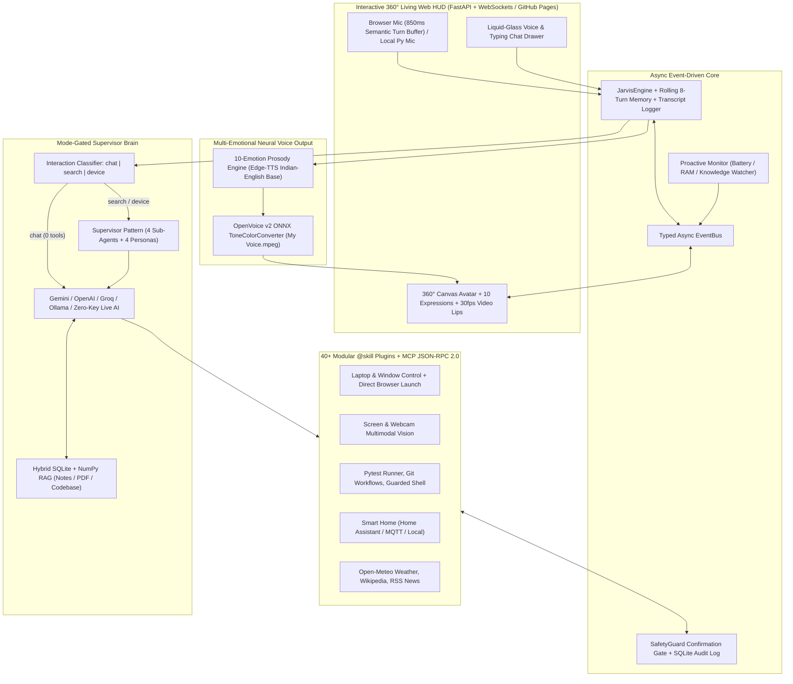

# J.A.R.V.I.S. — Interactive 360° Living AI Voice Assistant

[](https://shashankjha-2003.github.io/J.A.R.V.I.S-Assistant/)
[](https://www.python.org/)
[](https://fastapi.tiangolo.com/)
[](https://github.com/myshell-ai/OpenVoice)

A production-grade, multimodal **Python AI Voice Control Assistant** featuring a **360° interactive living portrait HUD**, **local multi-emotional neural voice cloning** (`OpenVoice v2` ONNX on CPU), **mode-gated Supervisor multi-agent reasoning**, **semantic turn detection**, **screen & webcam vision**, **PDF/codebase hybrid RAG**, **MCP JSON-RPC 2.0 tool integration**, **proactive system alerts**, **smart home IoT**, and **human-in-the-loop safety guardrails**.

> **Try the Live Interactive Avatar right in your browser:**  
> 👉 **[https://shashankjha-2003.github.io/J.A.R.V.I.S-Assistant/](https://shashankjha-2003.github.io/J.A.R.V.I.S-Assistant/)**  
> *(Supports 360° drag-to-rotate, all 10 facial expressions, live blinking & breathing, real-video talking lips, voice & typing chat, live weather, Wikipedia, and direct site opening!)*

---

## Highlights & Key Features

### 1. 360° Living Expressive Avatar HUD
- **Seamless Studio Portrait**: 3-layer organic studio dissolve seamlessly merges the portrait, corners, and jacket into the dark charcoal studio backdrop—zero card borders.
- **10 Calibrated Facial Expressions**: Automatically shifts across `neutral`, `listening`, `thinking`, `smiling`, `happy`, `laughing`, `serious`, `sad`, `angry`, and `surprised` with staggered eye/brow/mouth transitions.
- **Exact 30 FPS Real-Video Lip Sync**: Composites chronological mouth frames directly from real video (`talking me.mp4`) **strictly while speaking**—lips remain 100% static and closed on standby and across all 72/72 angles of manual **360° drag/scroll rotation**.
- **Human Micro-Life**: Anatomical top-down eyelid blinking (`blinking.jpg`), calm natural breathing, upright posture micro-sway, and empathetic listening nods.
- **4 Switchable Visual Modes**: `Face 360°`, `Liquid Orb`, `Spatial Halo`, and `Floating Pill`, plus a translucent **Liquid-Glass Typing Chat Drawer** (`💬 Chat`) synced with voice history.

### 2. Local Multi-Emotional Neural Voice Cloning (Zero GPU / Zero PyTorch)
- Powered by **OpenVoice v2** (`SynthesizerTrn` + HiFi-GAN) running locally via **`onnxruntime` FP32** (~0.35× real-time on CPU — under 1 second per reply).
- Clones the user's real voice from `My Voice.mpeg` (cached 256-dim vocal timbre embedding) while modulating **10 emotion-matched prosody profiles** (`happy`, `laughing`, `sad`, `angry`, `serious`, `surprised`, `smiling`, `thinking`, `listening`, `neutral`).
- ONNX weights (`tone_ref_encoder.onnx` + `tone_converter.onnx`) auto-download on first startup—nothing oversized committed to Git.

### 3. Mode-Gated Multi-Agent AI Brain & Zero-False-Search Routing
- **Explicit `chat` | `search` | `device` Router**: Physically disables web search and OS tools during casual conversation so banter never triggers random Wikipedia dumps.
- **Supervisor Pattern (4 Domain Sub-Agents)**: Routes specialized commands to `system_os_agent`, `code_workspace_agent`, `research_web_agent`, and `memory_productivity_agent`, with 4 selectable personas (`calm`, `crisp`, `witty`, `analytical`).
- **Multi-Provider LLM + Zero-Key Live Chat**: Supports **Google Gemini**, **OpenAI**, **Groq**, **Local Ollama**, and a built-in zero-API-key **Live Chat AI** fallback, with an **8-turn rolling conversation memory** and sub-50ms offline fast-path reflexes for 40+ skills.

### 4. Real-Time Voice Pipeline & Turn Detection
- **Semantic Turn-Taking + VAD**: 850ms natural pause window (`1650ms` hold on mid-thought connectors like `"and"`, `"about"`, `"open"`, `"um"`, `420ms` for instant commands like `"stop"`), Silero/Energy VAD, STT noise gate, instant barge-in interrupt, and exact Python transcript logging (`TRANSCRIPT: ...`).
- **Dual Microphone Modes**: Browser Web Speech API (`🎙 Talk` / `⚡ Hands-Free`) and local Python microphone capture (`sounddevice` + pluggable `faster-whisper` / Groq / OpenAI / Deepgram / Google STT).

### 5. Vision, RAG, MCP, Proactive Triggers, Smart Home & Safety
- **Screen & Camera Vision**: Capture active screen (or browser `getDisplayMedia` via `👁 Screen`) or webcam frames and analyze them with Gemini/OpenAI/Ollama Vision.
- **Hybrid Persistent Memory & Local RAG**: SQLite (WAL) + NumPy semantic vector store indexing local Markdown, text, **PDF**, and codebase files from `knowledge/`.
- **Model Context Protocol (MCP)**: JSON-RPC 2.0 client over HTTP/stdio dynamically registering external MCP tools into the skill registry.
- **Proactive Background Monitor**: Watches battery levels, high RAM usage, scheduled reminders, and live `knowledge/` file changes (auto-ingesting new notes into RAG).
- **Developer Workflows & Smart Home IoT**: Voice-triggered `pytest` summary reporting, Git branch/status/diff workflows, Home Assistant / MQTT / local smart-device control.
- **Human-in-the-Loop Safety Guardrails**: Explicit voice or HUD confirmation required before destructive operations (`shutdown`, `restart`, `run_shell_command`, `delete_workspace_file`, `kill_process`).

---

## System Architecture



---

## Quick Start (Full Local Python Edition)

### 1. Clone & Install
```powershell
git clone https://github.com/ShashankJha-2003/J.A.R.V.I.S-Assistant.git
cd J.A.R.V.I.S-Assistant

python -m venv .venv
.\.venv\Scripts\Activate.ps1
pip install -r requirements.txt
```

### 2. Optional `.env` Configuration
Copy `.env.example` to `.env` if you want to plug in **Gemini**, **OpenAI**, **Groq**, **Ollama**, **Home Assistant**, or **MQTT**—or leave it blank to run immediately with **zero API keys**:
```powershell
Copy-Item .env.example .env
```
*(You can also configure Gemini / OpenAI / Groq / Ollama live anytime from the top-right **`🧠 Live Chat AI`** panel in the Web HUD.)*

### 3. Launch J.A.R.V.I.S.
```powershell
# Launch the 360° Living Web HUD Dashboard (http://127.0.0.1:8765)
python main.py

# Run system diagnostics
python main.py --doctor

# Launch interactive Rich terminal CLI
python main.py --cli

# Run a single command directly from terminal
python main.py --command "what is my system status"
```

> **Note on Cloned Voice**: Place your own ~15–30s voice clip at `My Voice.mpeg` in the project root. On first launch, J.A.R.V.I.S. automatically downloads the OpenVoice v2 FP32 ONNX weights (~125 MB) into `data/models/openvoice_v2/` and caches your vocal timbre locally.

---

## Example Voice & Chat Commands

| Category | Examples |
|---|---|
| **Natural Chat** | `"Hey Jarvis!"` • `"Hey, long day today."` • `"I was thinking about movies earlier."` • `"Tell me a joke"` |
| **Direct Web & Media** | `"Open Google"` • `"Open YouTube"` • `"Open GitHub"` • `"Play lo-fi beats on YouTube"` • `"Pause music"` |
| **Live Knowledge** | `"What's the weather in Jabalpur right now?"` • `"Tell about MS Dhoni"` • `"Explain quantum computing"` |
| **System & Telemetry** | `"What is my system status?"` • `"Set volume to 50 percent"` • `"Dim screen"` • `"Take a screenshot"` |
| **Vision** | Click **`👁 Screen`** or say `"What's wrong with this error on my screen?"` • `"What do you see on my webcam?"` |
| **Dev & Workspace** | `"Run tests"` • `"Check git status"` • `"List git branches"` • `"Index my codebase"` |
| **Memory & Productivity** | `"Remember that my deploy port is 8080"` • `"Set a timer for 2 minutes"` • `"Calculate sqrt(144) + 25"` |
| **Smart Home & Persona** | `"Turn on desk lamp"` • `"Dim room lights to 40 percent"` • `"Switch persona to witty"` |
| **Guarded Safety Actions** | `"Shutdown my PC"` • `"Delete file temp.txt"` • `"Run shell command ..."` *(requires explicit Confirm/Cancel)* |

---

## Rebuilding the GitHub Pages Static Bundle

Whenever you update `jarvis/web/static/`, regenerate `docs/` with:
```powershell
python scripts/build_pages.py
```
Pushing to `main` automatically triggers [`.github/workflows/pages.yml`](.github/workflows/pages.yml) to deploy `./docs` to GitHub Pages.

---

## Automated Tests

```powershell
pytest -v
```
Covers semantic turn detection, mode-gated tool disabling on casual chat, rolling conversation memory, Supervisor routing & personas, multi-emotional voice cloning profiles & spectrogram geometry, PDF/codebase RAG, MCP JSON-RPC, proactive file watching, Smart Home IoT, safety confirmations, and FastAPI + WebSocket HUD endpoints (**23 tests passing**).

---

## Project Structure

```text
J.A.R.V.I.S-Assistant/
├── main.py                      # Entry point (Web HUD / CLI / Voice / Doctor)
├── My Voice.mpeg                # Reference audio for OpenVoice v2 voice cloning
├── jarvis/
│   ├── ai/                      # Mode-gated Brain, Supervisor, Intent Router, LLM Providers, Emotions
│   ├── core/                    # JarvisEngine, EventBus, SafetyGuard, MCP Client, Proactive Monitor
│   ├── memory/                  # SQLite WAL database & hybrid NumPy/PDF/codebase RAG vector store
│   ├── skills/                  # 40+ @skill tools (System, Apps, Web, Vision, Dev, IoT, Productivity)
│   ├── voice/                   # OpenVoice v2 ONNX Voice Cloner, Multi-Emotional TTS, STT, VAD, Turn Detector
│   └── web/                     # FastAPI + WebSocket server & 360° Living Avatar static assets
├── docs/                        # Standalone GitHub Pages static Web HUD deployment
├── scripts/build_pages.py       # Rebuilds docs/ from jarvis/web/static/
├── .github/workflows/pages.yml  # Automatic GitHub Pages CI/CD deployment
└── tests/                       # 23 automated pytest unit & integration tests
```

---

## License

MIT License — built by **Shashank Jha**.
